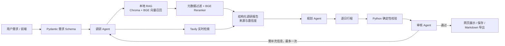

# 基于混合检索增强的 Multi-Agent 个性化旅行规划助手

> 一个可本地运行的端到端旅行规划项目：将用户需求结构化，结合本地 RAG 与实时检索完成调研，再由多 Agent 协作生成、校验和审核可执行的逐日行程。

传统攻略通常信息分散、时效不稳定，也难同时满足预算、出行人群、节奏等多重约束。本项目将“调研—规划—校验—审核”拆成职责清晰的 Agent 链路：调研 Agent 通过本地知识库与 Tavily 实时搜索收集证据；规划 Agent 基于结构化调研报告生成行程；Python 规则校验器检查硬约束；审核 Agent 负责质量判断，并最多触发一次有目标的补充调研与重规划。

## 项目亮点

- **混合检索而非静态问答：** 历史优质行程和旅行经验存入 Chroma；价格、天气、营业状态等高时效信息交给 Tavily 实时查询。
- **模型与 Agent 解耦：** 调研、规划、审核描述的是职责；DeepSeek 是可通过环境变量替换的 LLM 后端。
- **可解释的证据链：** 调研报告保存本地知识与实时网页的来源、分数和路由原因，前端可查看引用。
- **显式失败而非静默降级：** Live 模式不会在 API、CUDA 或本地模型失败后偷偷改用 Mock；错误会记录到结构化日志。
- **面向实际使用：** 提供网页交互、知识库浏览与新增、行程保存、Markdown 导出和 API 健康检查。

## 核心逻辑

（1）**意图解析与需求结构化：** 使用 Pydantic 将目的地、天数、预算、出行人群、兴趣、节奏和限制条件转为稳定 Schema，作为所有 Agent 与工具的统一输入，避免自然语言参数在链路中逐步丢失。

（2）**三 Agent 分工与模型解耦：** 调研 Agent、规划 Agent、审核 Agent 是由 LLM 驱动的执行单元，而 DeepSeek API 是可替换的模型后端。调研 Agent 使用 `deepseek-v4-flash` 并持有检索工具，规划和审核 Agent 使用 `deepseek-v4-pro`；三者不共享模糊的自由文本状态，只传递结构化对象。

（3）**调研 Agent 混合检索增强：** 调研 Agent 先从历史优质行程与旅行经验卡片中进行向量召回、元数据过滤和交叉编码重排；当问题具有票价、天气、营业状态等实时属性，或本地证据置信度不足时，再调用 Tavily。每次路由都记录 `route_reason`，最终输出带来源的结构化调研报告。

（4）**规划、规则校验与闭环审核：** 规划 Agent 根据调研证据生成逐日计划；确定性的 Python 校验器检查天数、预算、日程完整度和证据引用；审核 Agent 综合行程与校验问题给出结论。系统只允许一次定向补充调研，避免无上限 Agent 循环与费用失控。

## 系统架构



## 技术栈

- Python 3.11 / Pydantic / SQLAlchemy
- CrewAI / DeepSeek API / Tavily Search API
- LangChain / Chroma / HuggingFace Sentence Transformers
- `BAAI/bge-small-zh-v1.5` 向量模型 / `BAAI/bge-reranker-base` 重排模型
- FastAPI / Uvicorn / Jinja2 / 原生 JavaScript
- PyTorch CUDA（Live 模式要求可用的 NVIDIA CUDA 环境）

## 目录说明

```text
.
├── data/demo/                 # 可提交的 Demo 行程案例与旅行经验（JSONL）
├── docs/                      # 架构说明、运行手册与验收记录
├── src/travel_rag/
│   ├── agents/                # 调研、规划、审核 Agent 的 Live 实现
│   ├── domain/                # Pydantic Schema 与确定性规则校验
│   ├── rag/                   # Chroma、嵌入、重排、知识库管理
│   ├── tools/                 # 本地检索与 Tavily 实时检索工具
│   ├── persistence/           # SQLite 行程保存
│   ├── exporters/             # Markdown 行程导出
│   ├── static/ templates/     # 前端页面
│   ├── api.py                 # FastAPI 路由
│   └── workflow.py            # 调研—规划—审核闭环
├── tests/                     # 单元与接口测试
├── .env.example               # 不含任何真实密钥的配置模板
├── environment.yml            # Conda 环境定义
├── requirements-cuda.txt      # CUDA PyTorch 安装说明
└── pyproject.toml             # 项目依赖与 CLI 定义
```

## Demo 知识库

- `travel_cases`：40 条历史行程案例，北京、上海、西安、成都、杭州、广州、南京、重庆各 5 条。
- `travel_experiences`：66 条场景经验，覆盖亲子、长辈、交通、天气、预约、餐饮、体力与证据时效等主题。
- 长期知识库不保存当前票价、预约余量和营业状态；此类事实由 Live 模式实时检索。
- 源数据位于 `data/demo/*.jsonl`，Live 与 Mock 使用隔离的 Chroma 索引。

## 安全与运行模式

- `mock` 与 `live` 是显式模式；Live 链路失败时不会自动切换为 Mock。
- Live 模式缺少 API Key、CUDA、模型或索引时直接报错并写结构化日志。
- `.env`、日志、向量索引和本地模型不会提交到 Git。
- 默认测试不访问外网，也不会产生真实 API 费用。

## 快速开始

### 1. 创建环境并安装依赖

推荐使用 Conda 和 Python 3.11。先按你的 CUDA 版本安装 PyTorch（参考 `requirements-cuda.txt`），再安装项目依赖：

```powershell
conda activate travel-rag
python -m pip install --upgrade pip
python -m pip install -e ".[dev]"
Copy-Item .env.example .env
```

在 `.env` 中填写自己的密钥，**不要把 `.env` 提交到 Git**：

```dotenv
DEEPSEEK_API_KEY=你的_DEEPSEEK_KEY
TAVILY_API_KEY=你的_TAVILY_KEY
```

`.env.example` 仅提供键名与非敏感默认配置，真实 `.env` 已被 `.gitignore` 忽略。
模型缓存默认写入项目下的 `.cache/`（同样被忽略）；如需将缓存放在其他磁盘，可在 `.env` 中覆盖 `HF_HOME` 与 `TORCH_HOME`。

### 2. 先运行不消耗 API 的 Mock Demo

```powershell
travel-rag ingest-demo --mode mock
travel-rag demo --mock
travel-rag serve --mode mock
```

打开 `http://127.0.0.1:8000` 即可体验前端。Mock 适合演示页面与链路，不会访问外部模型或搜索服务。

### 3. 运行真实 Live 链路

Live 模式会使用 GPU 本地嵌入/重排模型，并调用 DeepSeek 与 Tavily：

```powershell
travel-rag download-models
travel-rag ingest-demo --mode local
travel-rag demo --live
travel-rag serve --mode live
```

浏览器访问 `http://127.0.0.1:8000`。健康检查为
`GET /api/v1/health`，就绪检查为 `GET /api/v1/ready`，规划接口为
`POST /api/v1/plans`。行程生成成功后，可以在结果区点击“下载 Markdown”，导出的
文档只保留需求概览、逐日安排和费用；对应接口为
`POST /api/v1/plans/export/markdown`。

### 4. 代理环境（可选）

若网络环境不能直接连接 DeepSeek 或 Tavily，可在**当前终端**设置本地 HTTP 代理后再启动服务。以下示例端口请按自己的代理软件修改：

```powershell
$env:HTTP_PROXY="http://127.0.0.1:7897"
$env:HTTPS_PROXY="http://127.0.0.1:7897"
$env:NO_PROXY="127.0.0.1,localhost"
travel-rag serve --mode live
```

这只影响从该终端启动的进程，不修改系统网络设置。

## API 概览

| 方法 | 路径 | 用途 |
| --- | --- | --- |
| `GET` | `/api/v1/health` | 服务存活检查 |
| `GET` | `/api/v1/ready` | Live 依赖、模型与知识库就绪检查 |
| `POST` | `/api/v1/plans` | 提交结构化旅行需求并生成方案 |
| `POST` | `/api/v1/plans/export/markdown` | 导出当前方案为 Markdown |
| `GET/POST` | `/api/v1/knowledge` | 查询或添加知识库记录 |
| `GET/POST` | `/api/v1/saved-plans` | 查询或保存完整行程 |

最小请求示例：

```json
{
  "destination": "北京",
  "days": 4,
  "budget_cny": 6000,
  "travelers": ["2位成人", "1名儿童"],
  "interests": ["历史", "亲子"],
  "pace": "relaxed",
  "constraints": ["每天仅一个高体力核心景点", "午间需要休息"]
}
```

## 保存与管理行程

行程生成成功后，可点击“保存到我的行程”。系统保存完整结构化结果，而不是提前保存
一份容易过期的导出文件；再次打开时恢复原方案，需要交付时再即时生成 Markdown。

- 本地行程库：`data/user/travel-rag.sqlite3`，首次保存时自动创建；
- 右上角“我的行程”支持按目的地或关键词查询、重新打开和下载；
- 同一 `request_id` 重复点击会返回原记录，不会产生重复行程；
- 当前版本只开放新增和读取，不提供网页删除操作；
- Markdown 只包含需求概览、逐日安排和费用。

对应接口为 `POST /api/v1/saved-plans`、`GET /api/v1/saved-plans`、
`GET /api/v1/saved-plans/{plan_id}` 和
`POST /api/v1/saved-plans/{plan_id}/export/markdown`。可通过环境变量
`PLANS_DB_PATH` 修改 SQLite 文件位置。

## 查看与手动添加知识

启动网页后点击右上角“管理知识库”：

- 可查看当前运行模式对应的 Chroma 集合，并按知识类型、目的地和关键词查询；
- 可选择“历史案例”或“旅行经验”，填写内容并确认后新增；
- 新增操作会先追加到 `data/demo/cases.jsonl` 或 `data/demo/experiences.jsonl`，
  再生成向量并写入当前索引；页面不提供删除功能；
- 如果向量写入失败，源数据会保留，错误会写入 `logs/travel-rag.jsonl`，系统不会
  静默切换模式或自动删除记录。

也可以直接编辑 JSONL 文件，每一行必须是一个完整 JSON 对象且 `id` 不得重复。
保存后按目标模式重建索引：

```powershell
# 更新 Mock 索引
travel-rag ingest-demo --mode mock

# 更新 Live 本地模型索引
travel-rag ingest-demo --mode local
```

历史案例必须包含 `days`、`pace`、`budget_level`；旅行经验必须包含 `scene` 和
`freshness`。其中 `freshness` 只能是 `stable`、`seasonal` 或
`realtime_required`，涉及价格、预约、天气和营业状态的内容应标记为
`realtime_required`。

进一步说明：

- [系统架构与面试讲解](docs/architecture.md)
- [本地运行手册](docs/runbook.md)
- [Live Demo 验收报告](docs/live-demo-report.md)

## 测试与质量检查

```powershell
python -m pytest
python -m ruff check src tests
```

测试使用 Mock 组件，不会请求 DeepSeek、Tavily 或下载模型。提交前建议执行以上两项检查。

## 已知边界

- 本项目是本地 Demo，不提供用户登录、多租户隔离或云端部署。
- 本地案例适合沉淀相对稳定的路线与经验；价格、天气、余票、营业时间等必须以实时来源为准。
- Agent 审核用于质量控制，不替代真实预订前对官方渠道的最终确认。
- Live 模式需要有效 API Key、可用网络和 CUDA；任何一项缺失都会明确报错，而不会自动改用 Mock。

## 开源前安全清单

- [x] `.env`、日志、SQLite、Chroma 索引与模型缓存已忽略
- [x] `.env.example` 不包含真实密钥
- [x] Demo 数据为可公开的示例数据
- [x] README 不包含个人本机目录或访问凭证
- [ ] 依据发布意图选择并补充许可证（如 MIT）
