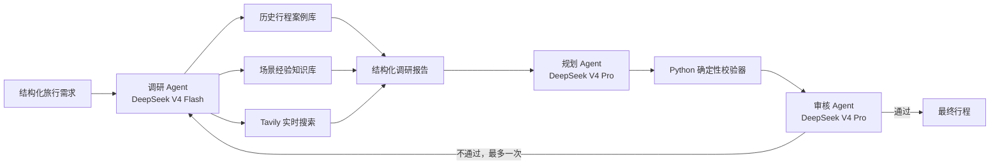

# 系统架构与面试讲解

## 1. 总体设计

**系统将模型能力、Agent 职责与工具能力分层，避免把“调研 Agent”误解成单一 API。**
DeepSeek API 是模型推理后端，Agent 是带角色、目标、Prompt、工具和输出 Schema 的执行单元；
RAG 与 Tavily 是调研 Agent 可以调用的工具。规划和审核 Agent 不直接访问检索工具，从而保证证据
先经过调研层整理，再进入规划与审核。

## 2. 调研 Agent 混合检索

**调研 Agent 先检索长期稳定知识，再依据时效性与置信度决定是否查询互联网。**
历史行程适合回答路线结构与景点组合，经验卡适合回答亲子节奏、体力控制、预算拆分等稳定策略；
票价、天气、营业状态、预约规则和临时限流等当前事实必须交给 Tavily。

一次本地检索包含三个阶段：

1. **向量召回：** `bge-small-zh-v1.5` 将查询与知识文本映射到 512 维向量，
   Chroma 使用余弦距离召回语义相近的候选。
2. **元数据过滤：** 在向量搜索时限制 `destination`，经验库只允许目标城市或“通用”卡片，
   防止“上海亲子四日”因语义相似进入北京方案。
3. **结果重排：** `bge-reranker-base` 将“查询—候选文本”成对输入 Cross-Encoder，
   通过全注意力重新计算相关性，只保留 Top N 高质量证据。

调研工具返回 `local_confidence`、来源 ID、分数和 `route_reason`。当事实具有实时性，或本地最高
重排分数低于阈值时，Agent 调用 Tavily，并在 `ResearchReport.route_decisions` 中说明为什么使用
本地、实时或组合来源。

## 3. 三 Agent 的模型调用

**不同 Agent 可以接入不同模型，但应通过统一的 OpenAI-compatible 接口与结构化 Schema 解耦。**
调研 Agent 偏工具调用和信息整合，使用低延迟模型；规划 Agent 需要较强约束推理；审核 Agent
需要从需求、证据、行程与规则错误中作出判断。当前配置分别使用：

- Research：`deepseek-v4-flash`
- Planner：`deepseek-v4-pro`
- Reviewer：`deepseek-v4-pro`

模型名和 Base URL 均在 `.env` 中配置。如果实际服务商使用不同模型标识，只修改配置，不修改
Agent、工具或业务 Schema。

**DeepSeek 的结构化输出采用“原生 `json_object` 约束 + 本地 Pydantic 校验”。** DeepSeek
支持 `response_format={"type":"json_object"}`，但不支持 CrewAI `output_pydantic` 二次转换时
使用的 OpenAI `json_schema/parse` 协议。因此任务不配置 `output_pydantic`：Prompt 内嵌 JSON
Schema，DeepSeek 负责生成合法 JSON，Python 负责字段级 Pydantic 校验。结构化交接阶段显式关闭
thinking，避免推理 token 用尽输出预算导致最终正文为空。解析失败直接停止，不调用额外模型修复，
也不回退 Mock。

## 4. 校验与有限闭环

**硬约束由 Python 校验，主观质量由审核 Agent 判断，最多执行一次定向返工。**
校验器检查目的地、天数、日期序号、预算、早午晚完整度和证据 ID；这些确定性规则不交给 LLM，
避免模型“解释掉”明确错误。审核未通过时，只有缺少关键事实才补充调研；若只是路线或预算问题，
直接把修订指令交给规划 Agent。`retry_count <= 1` 防止无限循环、延迟与 API 费用失控。

## 5. Mock 与 Live 边界

**Mock 是显式测试模式，不是 Live 故障后的降级方案。** Mock 使用确定性 Hash Embedding、
字符重排和固定规划模板，不访问网络；Live 使用 CUDA BGE、Tavily 与 DeepSeek。缺少 Key、
CUDA、模型或索引时，Live 直接失败并写日志，不会自动切换到 Mock、CPU 或其他模型。

## 6. 可观测性与安全

**每个请求都应能够回答“调用了谁、为什么检索、耗时多少、失败在哪里”。** 日志采用 JSONL，
记录 request ID、运行模式、路由原因、模型/工具阶段、重试次数与异常类型；API Key、Token 和
Authorization 字段统一脱敏。Chroma 和 Hugging Face 的可选遥测在代码中显式关闭，`.env`、
日志、向量索引与模型缓存均被 Git 忽略。
